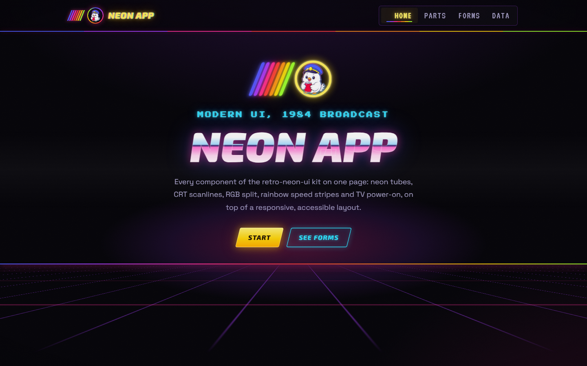
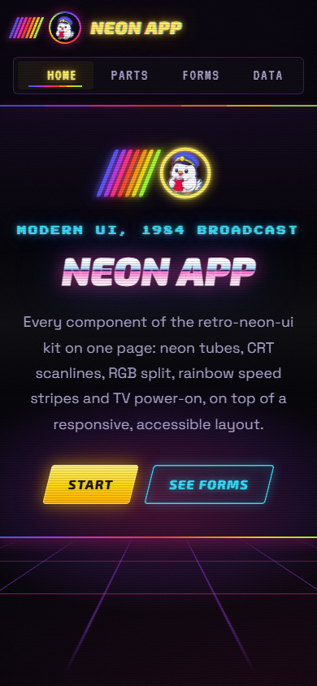
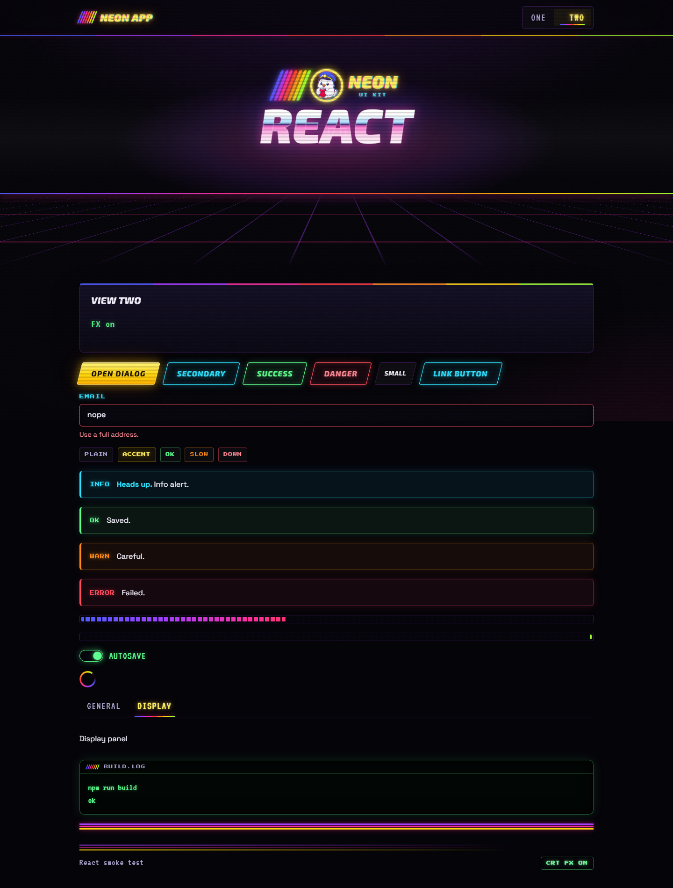
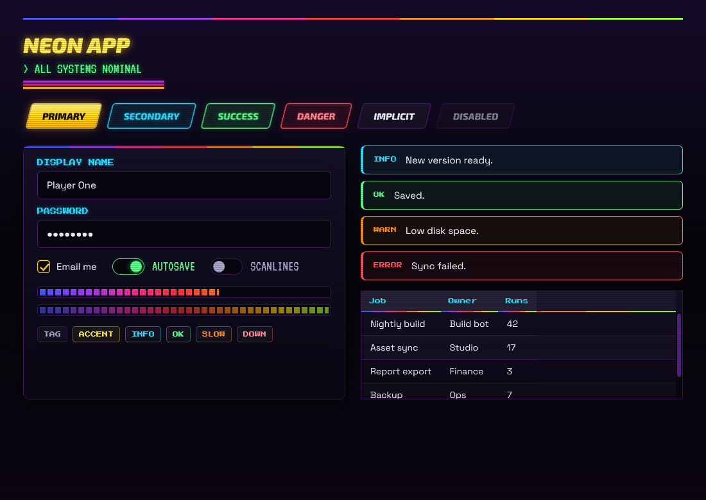
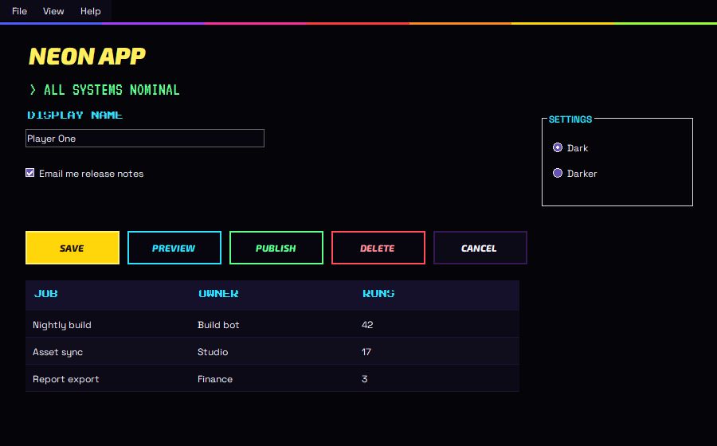
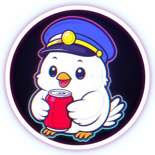
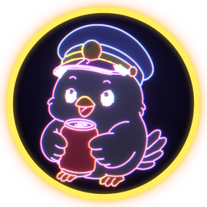
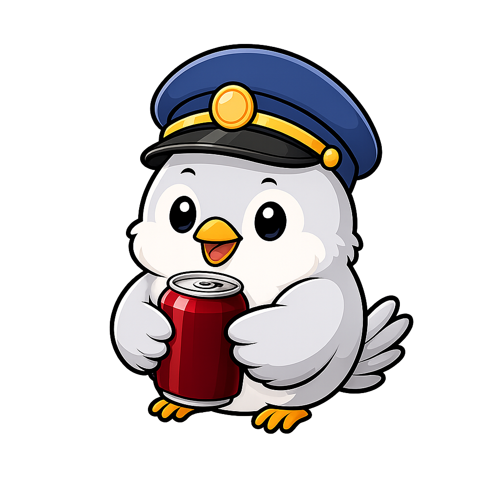
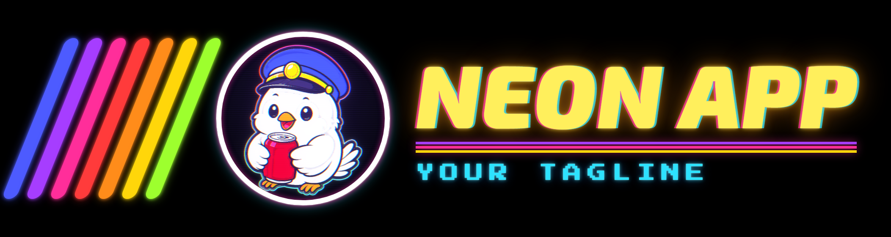

# retro-neon-ui

A design kit that gives software a modern, accessible UI with 1980s arcade and TV-ident flair: neon tubes on black,
CRT scanlines, RGB split, rainbow speed stripes, light trails, TV power-on and power-off. Retro wins where the two
clash, never at the cost of usability. One palette, one set of fonts, for the web (any framework), React, Tailwind,
SCSS, WPF and WinForms.



**AI coding agents:** read [CLAUDE.md](CLAUDE.md) and follow it. To restyle an app with an agent, tell it:
*"Read CLAUDE.md in https://github.com/AScotty27/retro-neon-ui and apply the theme to this app."*

## What is in it

| stack | files | what you get |
|---|---|---|
| web (HTML, server-rendered, Vue, Svelte, Angular ...) | `web/retro.css`, `web/retro.js`, `web/fonts/` | every component and effect; `web/demo/index.html` shows all of them |
| React 18+ | `react/RetroNeon.tsx`, `react/index.ts` (+ `web/retro.css`) | components and hooks, router-friendly, strict-typed |
| Tailwind v3 / v4 | `tokens/tailwind.preset.js` / `tokens/tailwind.theme.css` | `bg-rt-*`, `text-rt-*`, `font-rt-*`, `shadow-rt-*`, glows, stripes |
| SCSS | `tokens/_tokens.scss` | variables and maps |
| plain CSS variables | `tokens/tokens.css` | the `--rt-*` custom properties alone |
| WPF | `dotnet/wpf/*.xaml`, `dotnet/fonts/` | brushes, glows, fonts; styles for windows, text, buttons, inputs, check boxes, switches, progress, cards, alerts, tags, grids, scroll bars and tooltips; app-wide implicit styles |
| WinForms (.NET 8 or .NET Framework) | `dotnet/winforms/*.cs`, `dotnet/fonts/` | palette, font loader, one-call theme for a whole form, `StripeBar` |
| anything else | `tokens/tokens.json` | the palette, glows, fonts and radius as data |

`tokens/tokens.json` is the single source: `python tokens/build_tokens.py` regenerates every stack's token file.

## Quick start

**Web.** Copy `web/retro.css`, `web/retro.js` and `web/fonts/` into your assets, then:

```html
<html lang="en" class="rt">
<head>
  <link rel="stylesheet" href="/assets/retro.css">   <!-- before your own CSS -->
  <script src="/assets/retro.js"></script>           <!-- no defer -->
</head>
<body>
  <div data-rt-shell>
    <header class="rt-header">
      <a class="rt-brand" href="/"><strong>My App</strong></a>
      <nav class="rt-nav"><a href="/" aria-current="page">Home</a><a href="/reports">Reports</a></nav>
    </header>
    <main>
      <div class="rt-card">
        <h2 class="rt-subtitle">Hello</h2>
        <button class="rt-btn rt-btn-primary">Start</button>
      </div>
    </main>
    <footer class="rt-footer"><span>My App</span><span data-rt-fx-slot></span></footer>
  </div>
</body>
</html>
```

**React.** Copy `react/` and `web/retro.css` + `web/fonts/` into the app, import the CSS once, then:

```tsx
import { RetroRoot, NeonButton, NeonCard, FxSwitch, PowerOn } from "./retro-neon";

<RetroRoot>
  <PowerOn routeKey={location.pathname}>
    <NeonCard draw><NeonButton variant="primary">Start</NeonButton></NeonCard>
  </PowerOn>
  <footer className="rt-footer"><FxSwitch /></footer>
</RetroRoot>
```

**WPF.** Copy `dotnet/wpf/*.xaml` into `Themes\` and `dotnet/fonts/*.ttf` into `Fonts\` (Build Action Resource),
merge `Themes/RetroNeon.Implicit.xaml` in `App.xaml`, and give each window `Style="{StaticResource Rt.Window}"`.

**WinForms.** Add `dotnet/winforms/*.cs`, copy the fonts to the output's `Fonts\` folder, call `RetroFonts.Load()` in
`Main`, then `RetroTheme.Apply(this)` after `InitializeComponent()`.

Full steps, the component map and the traps: [CLAUDE.md](CLAUDE.md). Per-stack details and limits:
[docs/stacks.md](docs/stacks.md). Every effect explained: [docs/flair.md](docs/flair.md).

## Components

Header, brand, nav (with an arcade `▶` on the active item and a glyph scramble on hover), sidebar nav, buttons
(primary, secondary, success, danger, neutral, small, disabled), cards (stripe cap, border beam, hover lift), fields
(label, hint, invalid), switch, tags, alerts, level-meter progress (and indeterminate), spinner, tabs, table, native
dialog and overlay modal, tooltip, terminal block, breadcrumbs, pagination, empty state, page header with a status
line, hero (chrome title, kicker, synthwave floor), ident mark, light trail, footer with the CRT FX switch, CRT
overlay, attract-mode intro, TV power-on and power-off, reveal on scroll.

Accessibility is part of the kit: visible focus rings, `prefers-reduced-motion` honoured everywhere, a CRT FX switch
that is remembered per browser, glitch headings read once by screen readers, `[hidden]` always respected, nothing
that blinks for long without a way to stop it.

| phone | React | WPF | WinForms |
|---|---|---|---|
|  |  |  |  |

More: [the whole demo page](docs/screenshots/demo-desktop.png), [the intro](docs/screenshots/demo-intro.png),
[a dialog](docs/screenshots/demo-dialog.png).

## The logo

`logo/` holds the repo owner's bird logo in the same style, in two versions:

| normal (TV ident) | inverted (neon sign) | the original it derives from |
|---|---|---|
|  |  |  |

- **normal** (`logo/normal/`): the white bird in bright flat colours with a glowing pink-to-cyan rim. Reads down to
  32 px, so it is the everyday logo: headers, favicons, avatars.
- **inverted** (`logo/inverted/`): the bird drawn as lit neon tubes on dark tinted parts. Best at 128 px and up, for
  big moments (intros, banners).
- **reference** (`logo/reference/original-bird.png`): the original cartoon both sets were traced from. Both neon
  versions derive from it; it is here so the derivation is clear and the set can be rebuilt.

Each version has `bird-transparent.png`, `bird-on-black.png`, `badge-transparent-<1024..16>.png` (bird in a lit ring
on a dark disc), `badge-on-black-1024.png` and `disc-<1024|256|128>.png` (no ring, for slots that draw their own);
`logo/web/` has `favicon.ico`, `favicon-64.png` and `apple-touch-icon.png`. Transparent files carry their glow in
the alpha channel; viewers that ignore alpha show it as solid blocks, so use the `-on-black` copies to judge them.

How the set is made: `logo/tools/neon_logo.py` splits the cartoon into parts by colour, thins the black ink to centre
lines and redraws them as even neon tubes, then adds bloom, scanlines and RGB split; `render_lockups.py` renders the
badges (and a full lockup with any name: `--name "My App" --tag "My tagline"`) with the kit's own fonts;
`export_brand.py` writes the set. Example lockup with the placeholder name:



The logo images are **not** MIT-licensed (see [logo/LICENSE.md](logo/LICENSE.md)); the tools are.

## Tests

`python tests/run_all.py` runs everything (add `--docs` to refresh the screenshots in `docs/screenshots/`):

| check | what it proves |
|---|---|
| `tokens/build_tokens.py --check` | every generated token file matches `tokens.json` |
| `tests/check_png_chunks.py` | every PNG and ICO frame is pixel data only (no text, profile or time chunks), with a planted control |
| `tests/check_logo.py` | the logo set rebuilds byte-identical from the reference image |
| `tests/react` (`npm run typecheck`, `npm run build`) | the React layer type-checks under `strict` and bundles |
| `tests/check_web.py` | 56 browser checks of the demo and React pages, desktop and phone, zero console errors |
| `tests/wpf` | the XAML compiles, every font key resolves to its shipped file, a sample renders offscreen |
| `tests/winforms` | the C# compiles, GDI really draws the kit fonts, the theme keeps app colours and RichTextBox formatting, a themed form renders offscreen |
| `tests/netfx` | the WinForms C# and the WPF XAML also build as a .NET Framework 4.8 library (C# 7.3) |

Needs Python 3 (tested with 3.12) with `pip install -r logo/tools/requirements.txt` and
`python -m playwright install chromium`; Node 18 or newer for the React check (tested with 24); the .NET 8 SDK on
Windows for the WPF and WinForms checks.

## Licences and credits

- Code: [MIT](LICENSE).
- Fonts (SIL Open Font License 1.1, licence files next to the fonts): Exo 2 (The Exo 2 Project Authors), Space
  Grotesk (The Space Grotesk Project Authors), Press Start 2P (The Press Start 2P Project Authors; Reserved Font
  Name, so it ships as the unmodified upstream TTF), VT323 (The VT323 Project Authors). `dotnet/fonts/` holds static
  instances of the Exo 2 and Space Grotesk variable fonts.
- Logo images: not MIT, see [logo/LICENSE.md](logo/LICENSE.md).
- The look: 1980s TV station idents and arcade attract screens.
