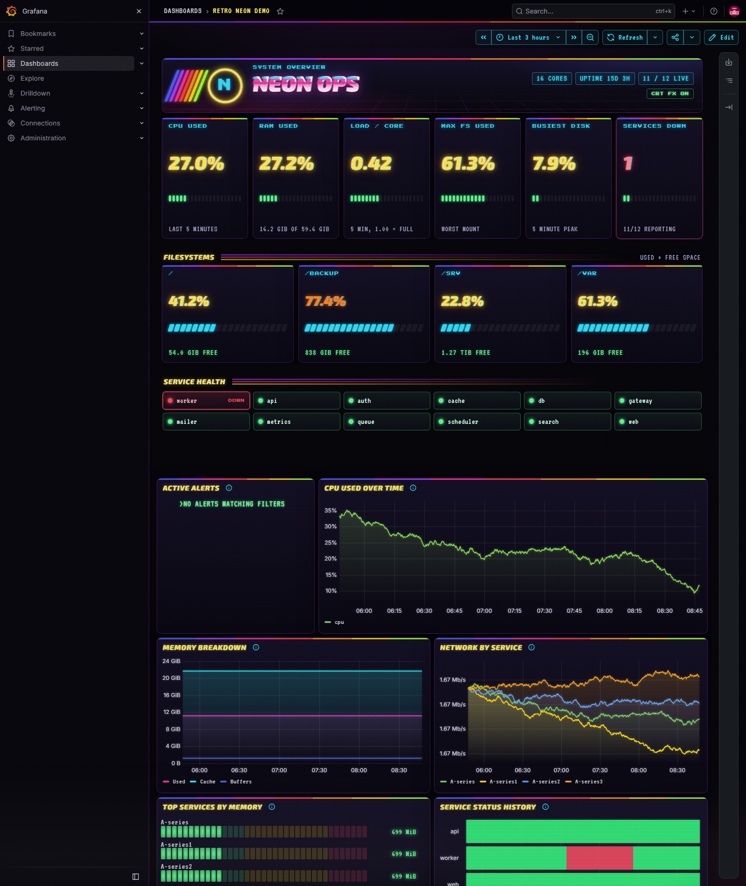

# retro-neon-ui for Grafana

Give any Grafana dashboard the retro-neon-ui look: a dark neon page, stripe-capped panels, neon titles, glowing
charts, LCD bar gauges, CRT scanlines with a CRT FX switch, an optional attract-mode intro, and three retro panel
kinds (a status HUD with LED meters, storage power cells, a service health grid). Presentation only: every query
and every panel's info note is kept, and the tool refuses to write a dashboard where one changed.



## Requirements

- Grafana 13.2.4 is what this was built and tested on. Older and newer versions should work for the data panels;
  the page theme hooks into Grafana's `data-testid` attributes, which an upgrade can move (the data keeps working,
  only the cosmetic layer would need a touch-up).
- The **HTML Graphics** panel plugin (`gapit-htmlgraphics-panel`, 2.2 or later, signed, from the Grafana plugin
  catalog) for the retro panels and the page theme. Without it, use `--native-only` (colours and LCD only).
- Python 3.8+ to run the tool (standard library only).
- A Grafana `content_security_policy` that blocks inline styles would block the page theme; the default has none.

## Use it

1. Export the dashboard: Dashboard > Share / Export > Export as JSON (or `GET /api/dashboards/uid/<uid>`, either
   shape works).
2. Write a small config (or none, for the defaults): see the examples and the reference below.
3. Theme it:

   ```
   python grafana/tools/apply_theme.py my-dashboard.json --config retro.json -o my-dashboard-retro.json
   ```

   Flags: `--copy NEW_UID` (write a copy to try first: new uid, " (retro)" on the title; the page theme is scoped to
   the new uid), `--native-only` (colours and LCD only: no HTML panels, no page theme, for Grafanas without the
   plugin), `--uid UID` (only for an export that has no uid; an existing uid is never overwritten).
   Do not edit the uid in the OUTPUT: the page theme is baked to the uid it was built for. Theming an already themed
   dashboard is refused; theme the original export again instead.

4. Import it: Dashboards > New > Import > upload the file (same uid = it replaces the dashboard; build with
   `--copy` to import it next to the original), or `POST /api/dashboards/db` with
   `{"dashboard": <file>, "overwrite": true}`.
5. Before replacing a dashboard people rely on, note its current version: Settings > Versions restores it in one click.

The theme is scoped to the dashboard's URL (`/d/<uid>`): it switches on when the dashboard opens and off as soon as
you navigate elsewhere in Grafana, so other dashboards are untouched.

## Config reference (`retro.json`)

```json
{
  "intro": {"title": "NEON OPS", "tag": "System overview", "logo": "https://.../logo.png"},
  "banner": {"title": "My dashboard", "kicker": "Team name", "logo": ""},
  "add": [ {"kind": "status-hud | storage-cells | service-grid | banner", "height": 11,
            "description": "info note", "targets": [ ...queries... ], "config": { ...kind config... }} ],
  "replace": { "<panel id>": {"kind": "service-grid", "config": { ... }} },
  "seriesColors": { "<panel id>": {"<series name>": "#ff2e9a"} },
  "extraUids": ["another-dashboard-uid"]
}
```

- `intro` (optional): the attract-mode intro, at most every 12 h per browser, never with reduced motion or with
  CRT FX off; `?rt-intro` in the URL forces it. No `logo`: the title's first letter sits in the ring. Leave the
  intro out for dashboards people open many times a day.
- `add`: retro panels inserted at the top, in order, full width (everything else moves down). The first one also
  carries the page theme. Each entry: `kind`, `config`, `targets` (its own queries), `description` (info note),
  `height` (default: banner 3, status-hud 11, storage-cells 7, service-grid 10), `datasource` (default: the first
  data source found on the dashboard). With no `add`, a slim `banner` built from the top-level `banner` config
  (dashboard title + CRT FX switch) is added to carry the theme; `banner` is ignored when `add` has entries.
- `replace`: turns an existing panel into a retro kind, keeping its queries, info note and position (`seriesColors`
  does not apply to a replaced panel).
- `seriesColors`: fixed neon colours per series name for one panel. By-value colour schemes (green-yellow-red)
  are left alone: there the colour is the data.
- `extraUids`: other dashboard uids that should also get the page theme when they render this runtime.

Kind configs (queries are matched by `refId`, never by order; a missing value shows `--`, never a fake zero):

| kind | config |
|---|---|
| `status-hud` | `title` (may use `$variables`), `kicker`, `logo`; `meters`: `label`, `value` (`"A"` or `{"ratio": ["B", "C"], "scale": 100}`), `format` (`percent`, `number`, `number2`, `int`, `bytes`, `duration`), `warn`, `crit`, `bar` (`{"max": 100}` or `{"maxRef": "K"}`), `hint`, `status`, `warnText`, `critText`; `chips`; `okText`, `noDataText`. Text fields take `{REF:format}` and `{value:format}`. The status line names the worst problem first. A meter without `bar` fills its 20 LEDs on a 0 to 100 scale, so give counts, loads and bytes a `bar`. |
| `storage-cells` | `title`, `subtitle`, `usedRef` (percent used per series), `freeRef` (bytes free), `label` (series label, e.g. `mountpoint`), `order`, `names`, `warn` (75), `crit` (90). Every series gets a cell, so new mounts appear on their own. |
| `service-grid` | `title`, `refId`, `label` (e.g. `job`, `instance`, `name`), `downWhen` (`zero` for Prometheus `up`, `nonzero` for a 0/1 "is down" query), `noun`. Down tiles first (red, blinking), data gaps grey `?`. |
| `banner` | `title` (default: the dashboard title; may use `$variables`), `kicker`, `logo`. |

## Examples

- `examples/testdata-demo/`: runs on Grafana's built-in TestData source, no real metrics (one service is down on
  purpose). `make_demo.py` writes `source.json` + `retro.json`; `retro-neon-demo.json` is the themed result. Create a
  TestData data source with uid `rt-testdata` first (`tests/check_grafana.py` does it for you).
- `examples/linux-overview/`: node_exporter + cAdvisor, with `$ds`, `$instance`, `$cadvisor`, `$mountpoint` and
  `$container` variables; HUD (CPU, RAM, load per core, worst mount, busiest disk, containers down), storage cells,
  container grid, and the usual charts. `linux-overview-retro.json` is ready to import.

## Checks

`python tests/check_grafana.py` (also step 9 of `tests/run_all.py`): the examples rebuild byte for byte, every panel
script parses, the query and info-note guards are control-tested, every page rule is scoped, and each retro panel's
logic runs in Chromium with fake data. With `RT_GRAFANA_URL` plus `RT_GRAFANA_USER`/`RT_GRAFANA_PASSWORD` (or
`RT_GRAFANA_TOKEN`) it also imports the demo into that Grafana and checks it end to end. **Point it at a throwaway
Grafana, never a production one** (a local one: Grafana's zip or container, plus `grafana cli plugins install
gapit-htmlgraphics-panel`).

## How it works

- `theme/global.css`: the page theme; every rule under `body.rt-grafana`; selectors use Grafana's stable
  `data-viz-panel-key`, `data-plugin-id` and `data-testid` attributes, never its generated `css-xxxx` classes.
- `theme/runtime.js`: prepended to the first retro panel's code; adds the stylesheet (fonts embedded, no
  third-party requests) and the CRT overlay once, toggles `body.rt-grafana` by URL every 700 ms, plays the intro.
- `panels/`: each kind's HTML is built by the tool, its CSS (`panel-base.css` + the kind's file) and script go into
  the panel. Each panel renders in its own shadow DOM.
- Traps: never set `position` on Grafana's top `<header>` (it breaks the layout); the intro can only start once the
  dashboard has rendered, so Grafana shows for a moment first.
